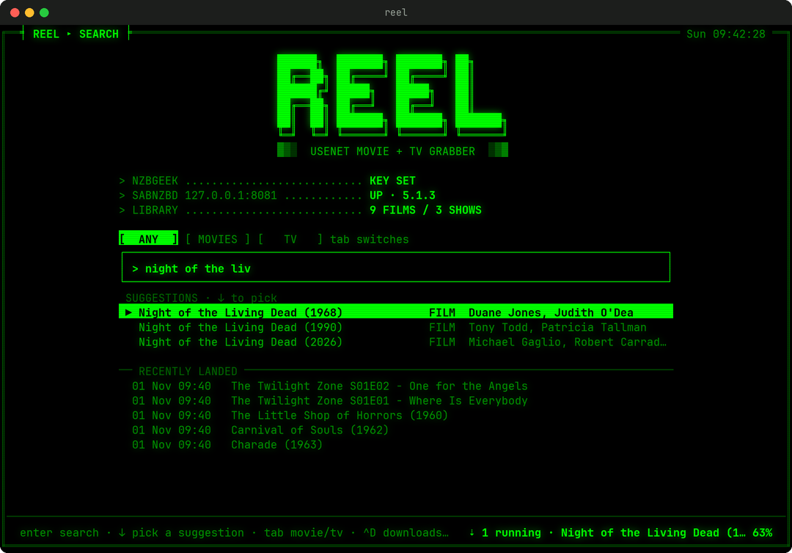
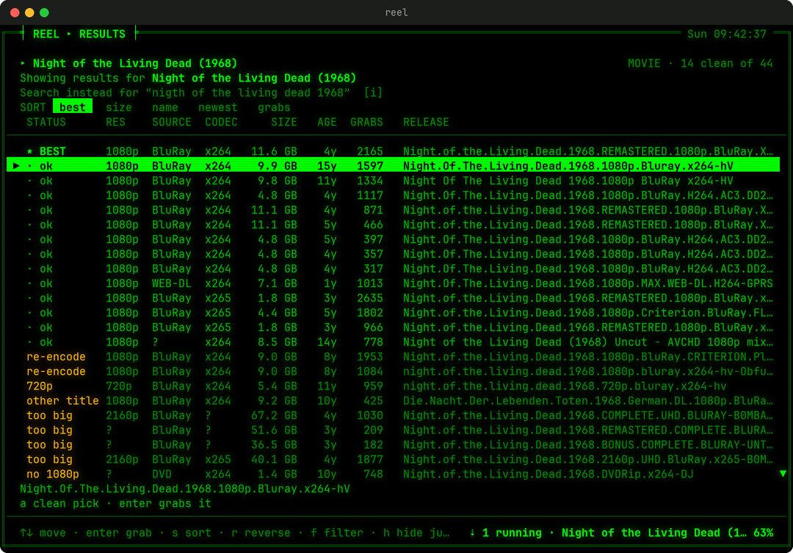
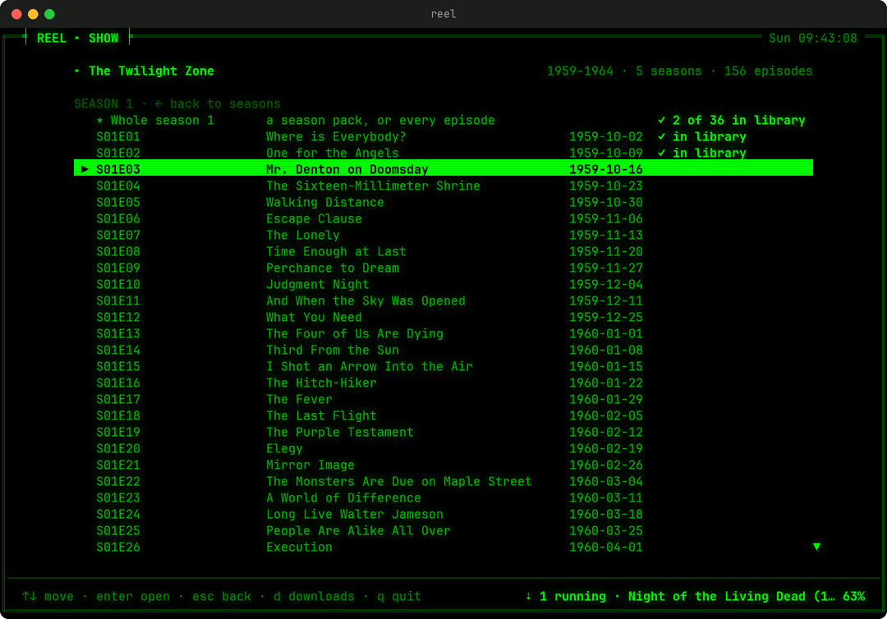
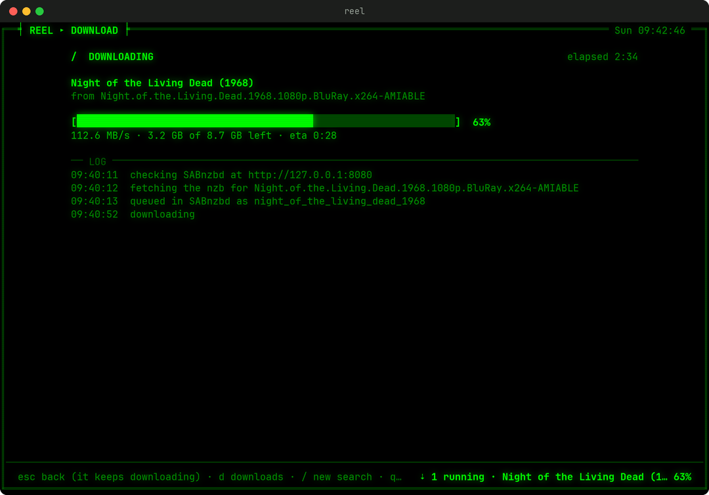

# reel

A terminal app for picking movies and TV episodes off usenet. You type a title, pick the exact release you want with the arrow keys, and it downloads through SABnzbd and lands in your library with a proper name.



It works on Windows, macOS and Linux.

## What it does

- Suggests titles as you type, and fixes typos. "knowign 2009" searches Knowing (2009) and says "Showing results for Knowing (2009)", with a key to search what you typed instead. When it isn't sure, it searches what you typed and asks "Did you mean".
- Shows every release the indexer has, with the clean ones on top and the rest marked with the reason (720p, cam rip, dubbed, disc image, too big, failed before). You can still pick any of them.
- Sorts by recommended, size, name, newest or most grabbed, and filters by any word in the release name.
- For a TV show, lists the seasons and episodes (from TVmaze) and marks the ones already in your library. You can grab one episode, a season pack, or every episode of a season you don't have yet.
- Downloads keep running if you close reel. Season packs get split into one properly named file per episode.







## What you need

1. A usenet provider account. This is a paid subscription that gives you a server address, a username and a password.
2. An indexer account with API access. reel is set up for NZBGeek (paid), and any other newznab indexer works too.
3. SABnzbd (free), installed and connected to your usenet provider.
4. Python 3.9 or newer. On Windows, use Windows Terminal (it comes with Windows 11) so the boxes and colors draw correctly.

Sonarr, Radarr and Jellyfin are optional. reel doesn't need them, and it stays out of their way (see "Sonarr and Radarr" below).

## Setting it all up with Claude Code

If you have Claude Code, [SETUP-PROMPT.md](SETUP-PROMPT.md) has a prompt you can paste into it. It installs and connects SABnzbd, reel, Prowlarr, Sonarr, Radarr and optionally Jellyfin, asking you for your account details along the way.

## Installing reel by hand

Windows (in Windows Terminal):

```
winget install Python.Python.3.12
py -m pip install --user https://github.com/voidharbor/reel/archive/refs/heads/main.zip
py -m reel
```

macOS (in Terminal):

```
python3 -m pip install --user https://github.com/voidharbor/reel/archive/refs/heads/main.zip
python3 -m reel
```

If pip on the Mac refuses with "externally-managed-environment", install it with pipx instead:

```
brew install pipx
pipx ensurepath
pipx install https://github.com/voidharbor/reel/archive/refs/heads/main.zip
reel
```

Once the folder pip installs scripts into is on your PATH, plain `reel` works too. `py -m reel` (Windows) and `python3 -m reel` (Mac) always work.

To update, run the same install command with `--force-reinstall` added after `install`.

## First run

The first time, reel opens its settings screen and asks for:

- your indexer API key (NZBGeek: sign in, open your profile, copy the API key)
- the SABnzbd address and API key (filled in by itself when SABnzbd is on the same computer; otherwise it's in SABnzbd under Config, General, Security)
- where finished movies and TV episodes should go (default `~/Media/Movies` and `~/Media/TV`)

Pick SAVE and it tests each one. To change them later, press Ctrl+P on the search screen or run `reel --setup`. To test everything without opening the app:

```
reel --check
```

(or `py -m reel --check` on Windows and `python3 -m reel --check` on a Mac, if plain `reel` isn't found)

## Using it

Type a title on the search screen. You can add a year (`knowing 2009`), a season (`breaking bad s01`) or an episode (`superjail s01e02`). Press the down arrow to pick one of the suggestions, or Enter to search what you typed.

| Key | Where | What it does |
|---|---|---|
| Enter | everywhere | search, open, grab |
| ↑ ↓ (or j k) | lists | move |
| Tab | search | switch between any, movies only and TV only |
| Esc | everywhere | go back one screen; on the search screen it quits |
| s / r | results | change the sort / reverse it |
| f | results | filter by words in the release name (`-word` leaves those out) |
| h | results | hide everything that isn't a clean pick |
| i / m | results | search what you typed instead / take the "Did you mean" |
| d or Ctrl+D | anywhere | the downloads list |
| Ctrl+P | search | settings |
| q | lists | quit |

In the results, the STATUS column says what reel thinks of each release:

- `★ BEST` is the recommended pick: the right title, the right resolution, no problems found, with BluRay over WEB-DL and x264 over x265 (it plays on more devices), and the most-grabbed release winning a tie.
- `· ok` is a clean pick. `· pack` is a clean season pack.
- `✓ have` means that episode is already in your library.
- Anything else is the reason it isn't recommended: `720p`, `cam / screener`, `remux`, `disc image`, `dub / other language` words like `MULTI` or `GERMAN`, `extras only`, `too big`, `other title`, `failed before`.

Press Enter on a release to see where it will be saved. You can edit that path before pressing Enter again to start.

## Where files go

Movies: `~/Media/Movies/Knowing (2009)/Knowing (2009).mkv`

Episodes: `~/Media/TV/Superjail/Season 01/Superjail S01E02 - Combaticus.mkv`

If a show already has a folder in your TV library, new episodes go into that folder. The file extension follows what the file really is (mkv or mp4), and subtitle files that came with the release are moved along with it.

The naming patterns are in the settings file (see below) under `naming`. A `/` in a pattern makes a folder. Movie fields: `{title}`, `{year}`, `{res}`. Episode fields: `{show}`, `{season}`, `{episode}`, `{sxxexx}`, `{episode_title}`.

## Settings file

- Windows: `%APPDATA%\reel\config.json`
- macOS and Linux: `~/.config/reel/config.json`

The same folder holds the search history, the download logs (`jobs`), and `failed-releases.json`, the list of releases that failed for missing articles. Those are skipped for 30 days.

Other settings in the file:

- `quality.resolution`: the resolution the recommended pick looks for. `1080p` by default; `720p` and `2160p` work too.
- `quality.max_gb` and `quality.max_pack_gb`: anything bigger is marked `too big` (30 GB for a single release, 250 GB for a season pack).
- `lookups`: set to `false` to turn off IMDb suggestions and TVmaze episode lists. Search still works without them.

## Sonarr and Radarr

reel sends its downloads to SABnzbd under its own category, `reel`, so Sonarr and Radarr (which watch the `tv` and `movies` categories) never try to import something reel is handling. Add a `reel` category in SABnzbd (Config, Categories) if you want reel's downloads in a folder of their own; without one, they use SABnzbd's default folder, which is fine. Once reel moves a file into your library, Sonarr and Radarr see it on their next scan.

## When something goes wrong

- **"SABnzbd is not answering"**: start SABnzbd, then pick the release again. If it's running, check the address with `reel --check`.
- **The indexer rejects the key**: copy the API key again from the indexer's site and paste it in the settings screen (Ctrl+P).
- **A download fails with missing articles**: the release is incomplete on your provider. Go back to the list and pick another one. reel remembers the failed one and marks it `failed before`.
- **Lines and boxes look broken on Windows**: use Windows Terminal instead of the old Command Prompt window.
- **`reel` isn't found**: use `py -m reel` (Windows) or `python3 -m reel` (Mac).

## Uninstalling

```
py -m pip uninstall reel        (Windows)
python3 -m pip uninstall reel   (Mac, or: pipx uninstall reel)
```

Then delete the settings folder listed above.

## License

MIT. Only download what you have the right to.
